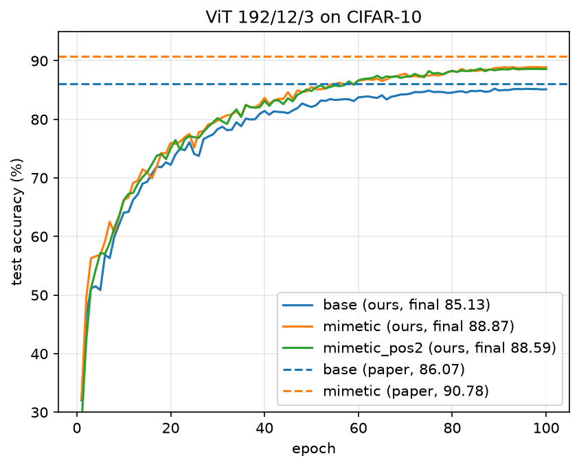
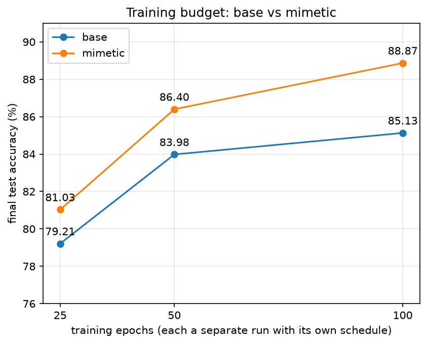

# Reproducing "Mimetic Initialization of Self-Attention Layers"

CT-468 Deep Learning, paper reproduction assignment. Team 404 Not Found: Syed Mohammad Huzaifa, Muhammad Maaz ur Rehman, Shaikh Muhammad Zain.

Paper: A. Trockman and J. Z. Kolter, Mimetic Initialization of Self-Attention Layers, ICML 2023, arXiv:2305.09828.

## 1. Paper summary

Problem. Vision Transformers (ViTs) trained from scratch on small datasets such as CIFAR-10 do much worse than CNNs. The usual fixes are large-scale pretraining or adding convolution-like parts to the model. The paper asks whether part of what pretraining gives is only a good starting point for the weights, so that a better initialization alone could close some of the gap.

Observation. In the attention layers of a ViT pretrained on ImageNet, the product W_Q W_K^T (query weights times transposed key weights) has a clear positive diagonal, and the product W_V W_proj (value weights times output projection) has a clear negative diagonal. A randomly initialized network shows neither pattern.

Method. Mimetic initialization sets the attention weights so that the two products have these patterns before training. With embedding width d, h heads and head width k = d / h, for every layer:

1. Query and key, per head: build M1 = alpha1 Z1 + beta1 I, where Z1 has entries from N(0, 1/d). Take the SVD M1 = U S V^T, keep the top k singular values, and set W_Q = U_k S_k^(1/2), W_K = V_k S_k^(1/2). Then W_Q W_K^T is the best rank-k approximation of M1.
2. Value and projection, whole layer: build M2 = alpha2 Z2 - beta2 I, take M2 = U S V^T and set W_V = U S^(1/2), W_proj = S^(1/2) V^T, so W_V W_proj = M2 exactly.

The paper uses alpha1 = beta1 = 0.7 and alpha2 = beta2 = 0.4, and fixed sinusoidal position embeddings. The explanation it gives: with W_Q W_K^T close to the identity, a token attends most to tokens with similar inputs, and through the position embeddings that means itself and nearby patches. Attention starts with a locality bias like a convolution, which a random ViT has to learn from data.

Baseline and main claim. The baseline is the same ViT with the default random initialization and the same training. Table 1 of the paper reports gains of 3.15 to 7.77 points on CIFAR-10 for ten ViT sizes. For the main model (width 192, depth 12, 3 heads, patch size 2) accuracy rises from 86.07% to 90.78%, a gain of 4.71 points. The paper also reports gains on CIFAR-100, Tiny ImageNet and ImageNet, and a much smaller gain (about 0.5) in the 300-epoch DeiT pipeline on ImageNet than in a 150-epoch pipeline (2.8 to 4.1).

We reproduce the main CIFAR-10 result for the 192/12/3 model. The paper has no official code, so the model, the initialization and the training script are our own plain PyTorch code. The paper has errors in equations 3 to 7: the subscripts of alpha and beta are swapped, and the given factorization does not multiply back to the target. We follow equations 1 and 2, which agree with the text and Figure 1.

## 2. Setup

Dataset. CIFAR-10: 50,000 training and 10,000 test images, 32 x 32 pixels, 10 classes. We use the official training and test split. There is no validation set (the paper does not describe one).

Model. ViT with width 192, depth 12, 3 heads (head width 64), patch size 2, so 256 patches plus a class token, 257 tokens in all. Pre-norm blocks, MLP ratio 4 with GELU, separate linear layers for query, key, value and projection, final LayerNorm, linear head on the class token. Position embeddings are fixed 1D sinusoidal over all 257 tokens. 5.34M parameters. Attention uses `F.scaled_dot_product_attention`; it computes the same formula as softmax(Q K^T / sqrt(k)) V but does not store the 257 x 257 matrix, which ran out of memory on the T4 at batch 512. Our self-test checks it against the hand-written formula (largest difference below 1e-6).

Initialization. Base: PyTorch default for every layer, class token at zero. Mimetic: as base, then the query, key, value and projection weights of every layer are set as in section 1, with a new Z1 per head and one Z2 per layer. Biases and all other layers keep the default. The self-test confirms the patterns: W_Q W_K^T has a diagonal mean of +0.39 to +0.40 per head (below 0.7 because of the rank-64 cut) against an off-diagonal mean |x| of 0.04, and W_V W_proj has a diagonal mean of -0.40 against 0.02.

Training (both inits). From the paper: AdamW, learning rate 3e-3, weight decay 0.01, batch 512, 100 epochs, RandAugment and Cutout. Settings the paper does not state, chosen by us:

- 5 epochs of linear warmup, then cosine decay to 0, updated every step
- RandAugment with 2 operations at magnitude 9, Cutout with one 16 x 16 square
- random crop with 4-pixel padding and horizontal flip before RandAugment (standard for CIFAR-10)
- no dropout, label smoothing or gradient clipping; weight decay on all parameters
- float16 mixed precision with a gradient scaler, seed 0, one run per setting

Hardware. Kaggle notebooks with one NVIDIA Tesla T4 (16 GB). One epoch takes 82 to 93 s, so a 100-epoch run takes about 2.3 to 2.6 h. All runs together used about 12 GPU hours. Code: `model.py`, `mimetic_init.py` and `train.py` (with a README for re-running).

## 3. Results

We report test accuracy at epoch 100. We fixed this before training, so the test set was not used to choose an epoch.

| Init | Paper (Table 1) | Ours | Ours minus paper |
|---|---|---|---|
| Base (default) | 86.07 | 85.13 | -0.94 |
| Mimetic | 90.78 | 88.87 | -1.91 |
| Gain from mimetic | +4.71 | +3.74 | -0.97 |

The claim holds: mimetic initialization beats the default by 3.74 points, 79% of the paper's gain. Mimetic is ahead for almost the whole run (Figure 1), by about 2 points at epoch 10 and 3.4 at epoch 50. It also fits the training set better (train accuracy 94.80 against 94.13, loss 0.149 against 0.167) while its train-test gap is smaller (5.93 against 9.00 points), so mimetic init improves generalization as well as fitting. Both runs had stopped improving: over the last ten epochs base stays between 85.00 and 85.22 and mimetic between 88.75 and 88.93. The best epochs are only 0.10 (base) and 0.06 (mimetic) above epoch 100.

## 4. Own experiment: does the gain depend on training length?

The paper's ImageNet results suggest that the gain shrinks with longer training, but that comparison also changes batch size, augmentation and other settings at the same time. We changed only the number of epochs: base and mimetic were trained as separate runs of 25 and 50 epochs, each with its own warmup and cosine schedule, all other settings and the seed as in section 2. The 100-epoch numbers are the main runs.

| Epochs | Base | Mimetic | Gain |
|---|---|---|---|
| 25 | 79.21 | 81.03 | +1.82 |
| 50 | 83.98 | 86.40 | +2.42 |
| 100 | 85.13 | 88.87 | +3.74 |

Mimetic is better at every length, and on CIFAR-10 the gain grows with training length, the opposite of the trend in the paper's ImageNet results. Mimetic at 50 epochs (86.40) is already above base at 100 epochs (85.13). From 50 to 100 epochs base gains 1.15 points and mimetic 2.47: base is close to its limit, while mimetic keeps improving. In our setting the advantage of mimetic init is largest at the end of long training. This does not contradict the paper's ImageNet result, where the longer pipeline also differs in many other ways, but it shows that training length alone does not remove the gain on CIFAR-10.

Limits: one seed per setting. Two mimetic runs that differ only in the position embedding scale (section 5) end 0.28 apart, which gives a rough idea of the run-to-run noise. The rise from +1.82 to +3.74 is far larger than that; the step from 25 to 50 epochs (+0.60) is less certain.

## 5. Gap analysis

Both our numbers are below the paper's, and the mimetic number by about twice as much (-1.91 against -0.94).

Tested: position embedding scale. The paper's ImageNet section says it used the CIFAR-10 hyperparameters "with a position embedding scale of 1", which suggests the CIFAR-10 runs used another scale, and its Figure 4 shows about +0.5 points from scale 1 to 2 with mimetic init. Since mimetic init works through the position embeddings, this could have explained why our mimetic gap is larger. We added a scale argument and trained one mimetic run with scale 2. It reached 88.59, 0.28 below scale 1. The scale does not explain the gap.

Remaining causes, not tested:

- Settings the paper does not state (section 2): schedule, augmentation strengths, crop and flip, MLP ratio, regularization. Each can move CIFAR-10 accuracy by tenths of a point, and they affect both inits, which fits the base gap of 0.94. They may also affect the two inits differently.
- Initialization of the other layers. The paper does not say how the patch embedding, MLP and class token are initialized or which code base it used. Many ViT code bases use a truncated normal with standard deviation 0.02; we use the PyTorch default.
- One run per setting. Part of each gap may be chance. The paper does not report how many runs its numbers come from.

Ruled out: under-training (accuracy was flat at the end), a wrong initialization (the self-test shows the target diagonals), the attention code (matches the hand-written formula), and final against best epoch (at most 0.1 point). Mixed precision is unlikely to matter, since the loss fell smoothly, but we did not run float32.

## 6. Conclusions

We reimplemented the ViT, mimetic initialization and the training pipeline from scratch and reproduced the paper's main CIFAR-10 claim. On ViT 192/12/3 mimetic initialization raises test accuracy from 85.13% to 88.87%, against 86.07% to 90.78% in the paper. The gain is 3.74 points against 4.71, and both absolute numbers are about 1 to 2 points lower. Our own experiment shows that on CIFAR-10 the gain grows with training length (+1.82, +2.42, +3.74 at 25, 50 and 100 epochs), and that mimetic init reaches the base model's 100-epoch accuracy in 50 epochs. Position embedding scale 2, our main suspect for the gap, did not help. The remaining gap most likely comes from settings the paper does not report, which only the authors' exact configuration or more runs could settle.

## 7. References and tools used

1. A. Trockman and J. Z. Kolter. Mimetic Initialization of Self-Attention Layers. ICML 2023. arXiv:2305.09828. (The paper we reproduce. It has no official code; our code is written from scratch.)
2. A. Dosovitskiy et al. An Image is Worth 16x16 Words: Transformers for Image Recognition at Scale. ICLR 2021. (The ViT model.)
3. A. Krizhevsky. Learning Multiple Layers of Features from Tiny Images. Technical report, University of Toronto, 2009. (CIFAR-10.)
4. E. D. Cubuk, B. Zoph, J. Shlens and Q. V. Le. RandAugment: Practical Automated Data Augmentation with a Reduced Search Space. CVPR Workshops 2020.
5. T. DeVries and G. W. Taylor. Improved Regularization of Convolutional Neural Networks with Cutout. arXiv:1708.04552, 2017.
6. I. Loshchilov and F. Hutter. Decoupled Weight Decay Regularization. ICLR 2019. (AdamW.)
7. A. Vaswani et al. Attention Is All You Need. NeurIPS 2017. (Sinusoidal position embeddings.)

Software and hardware: PyTorch and torchvision (model layers, AdamW, mixed precision, `F.scaled_dot_product_attention`, the CIFAR-10 loader and RandAugment), matplotlib (plots), Google Colab and Kaggle Notebooks with one NVIDIA Tesla T4. No other code or repository was used. Cutout, the learning-rate schedule, the ViT and the mimetic initialization are our own code.

AI tools: We used Claude (Anthropic), an AI assistant, as a helper during this project. We used it to explain parts of the paper and check our reading of its equations, to suggest and debug PyTorch code, to help set up and monitor the Colab and Kaggle runs, and to help draft and edit the notes and this report. The team chose the paper, decided the experimental setup (including the settings the paper does not state and our own experiment), checked the results against the training logs, and reviewed and edited all code and text before submission. Every team member has gone through the code line by line and can explain it.
